# vex

**2D vector game art as code.** Write a small `.vx.js` file of shapes, parts and variants;
vex exports SVG + PNG for every asset, animation strips and sprite atlases with
TexturePacker/Aseprite-style JSON, and previews with coordinate rulers that an AI agent can read.
A live viewer rebuilds on save and replays each asset step by step.

Built for AI agents (it ships as a Claude Code skill) and just as usable by hand.

> Part of a family: **vex** (vector art), [**pxl**](https://github.com/uilianks/pxl) (pixel art), [**chirp**](https://github.com/uilianks/chirp) (game audio), [**kiln**](https://github.com/uilianks/kiln) (low-poly and voxel 3D) and [**loom**](https://github.com/uilianks/loom) (seamless textures and PBR materials).
>
> Inspired by [**claude-pxl**](https://github.com/crsolver/claude-pxl) by crsolver, a pixel-art
> DSL for agents. vex takes its architecture (sandboxed art files, lazy cached builds, located
> errors, live painting viewer) and redesigns it for vectors: smooth shapes, gradients, glow,
> silhouette outlines, transforms, procedural animation, grain and blend modes.

## Showcase

Everything below was written as code in vex. Sources are in [`showcase/`](showcase/).

### LAST CUP: a cyberpunk noir scene

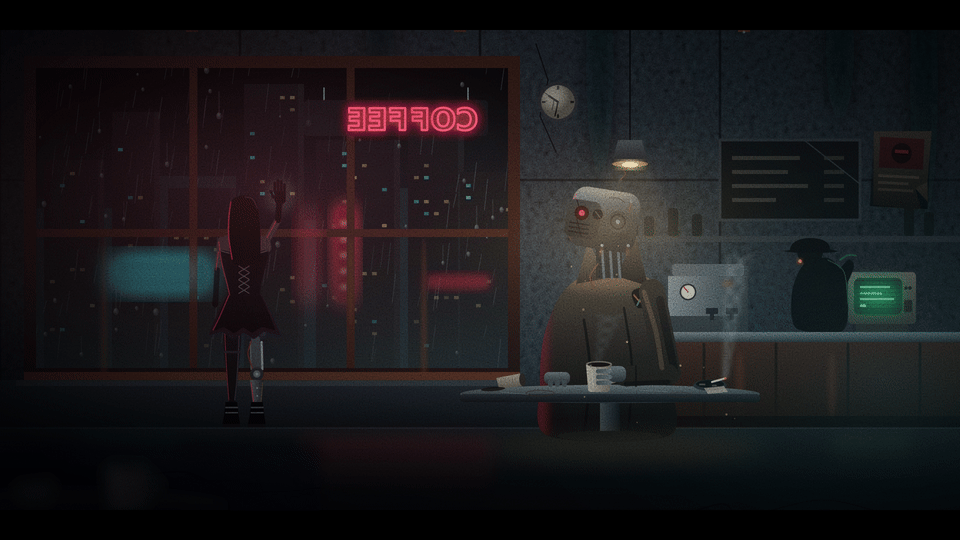

1920×1080 still: [`last_cup.png`](docs/media/last_cup.png) · 10 s 1080p loop: [`last_cup.mp4`](docs/media/last_cup.mp4) ·
source: [`noir_cafe.vx.js`](showcase/noir_cafe.vx.js)

Rain on the glass, a backwards neon sign with a dying letter, flickering CRT, smoke and steam,
film grain, all procedural and looping.

### Skeletal animation

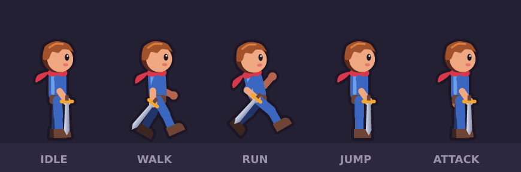

The Forest Kit hero as a 13-bone rig: hips, torso, head, two-part arms and legs, and a sword in
his hand. Five keyframed clips with easing, exported like any vex anim (strips, atlas + JSON).
Source: [`rigged.vx.js`](showcase/rigged.vx.js)

```js
const HERO = rig({
  torso:    { pivot: [24, 40], z: 4, items: [rect(19, 24, 10, 16, { fill: "tn1", r: 3.5 })] },
  armF:     { parent: "torso", pivot: [24, 28], z: 8, items: [line([24, 28, 24, 35], { stroke: "tn1", sw: 4 })] },
  forearmF: { parent: "armF", pivot: [24, 35], z: 8, items: [line([24, 35, 24, 41], { stroke: "sk1", sw: 3.6 })] },
})
anim("hero_walk", { w: 48, h: 64, frames: 8, fps: 10 }, pose(HERO, {
  armF: { rot: [[0, 22], [4, -22], [8, 22]] },          // [frame, degrees, ease into the next key]
  forearmF: { rot: [[0, -20], [4, -40], [8, -20]] },
}))
```

The same rig exports to **Spine 4.1** (`spine("hero", HERO, { clips })`): a skeleton JSON plus an atlas,
checked in the official Spine web player, so the animations run in any engine with a Spine runtime.

The same rig drives the LAST CUP robot's arm: ▶ **[watch him drink, 10 s with sound](docs/media/last_cup_sip.mp4)**.
A shoulder, elbow, hand and cup chain lifts the mug to his jaw while the cup bone counter-rotates
to keep the coffee level, and the room keeps its own 2 s rhythm of rain, flicker and grain.

### UI kit

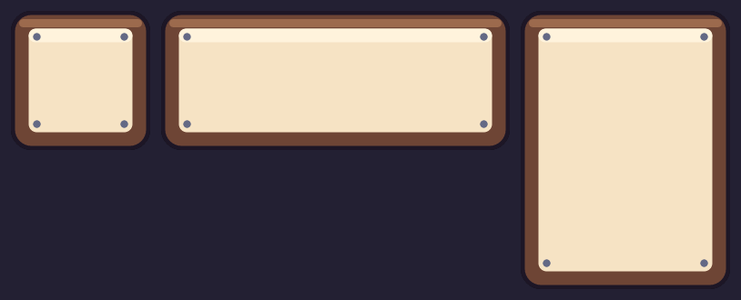

Stretchable 9-slice panels, buttons, bars and slots with margins exported for Godot, Unity and Phaser,
icons, and **bitmap fonts** (BMFont .fnt + .xml + atlas) with outline and shadow, all verified
in Phaser: its own `nineslice` objects and `bitmapText` using the exported files.
Source: [`ui_kit.vx.js`](showcase/ui_kit.vx.js)

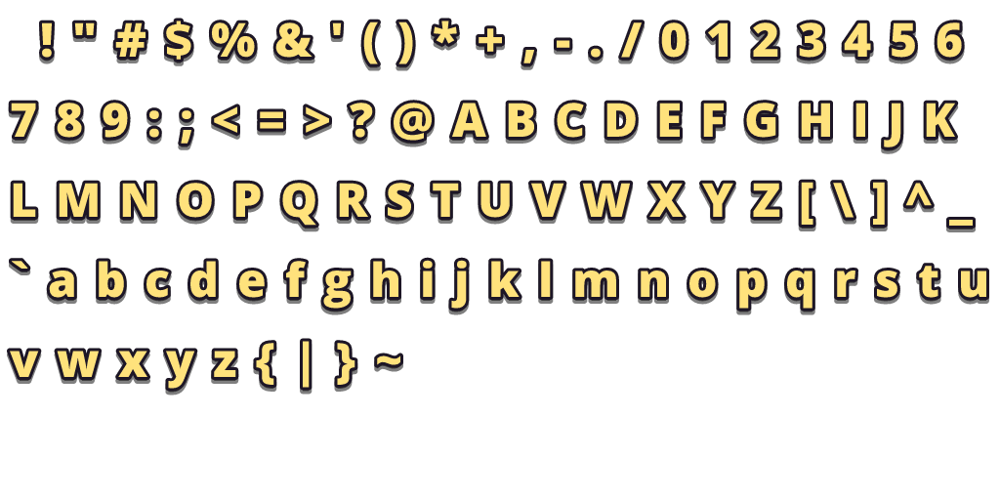

### Visual effects

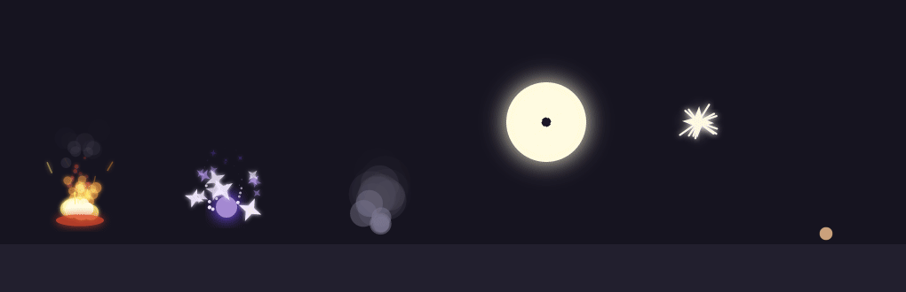

A deterministic particle system: spawn rates or bursts, life, speed, angle, gravity, drag, size, color and
opacity over life, sparks stretched along their velocity, glow and blend modes. Loops are seamless.
Source: [`vfx.vx.js`](showcase/vfx.vx.js)

### Levels

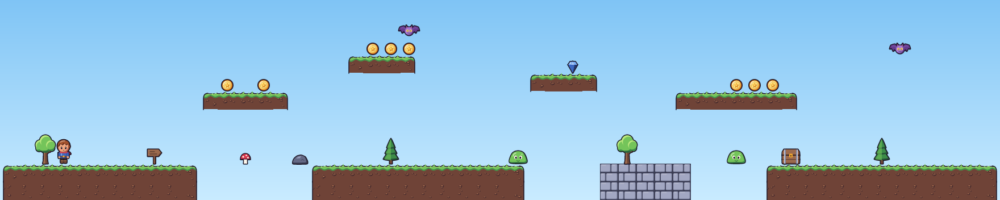
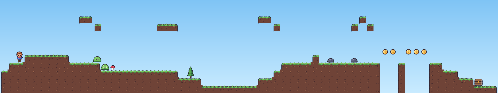

ASCII maps with a legend: autotiled terrain (grass tops, dirt fill, rounded caps), fixed tiles, and game
objects with types and properties. Maps can be generated with plain JS. Levels export to **Tiled**
(.tmj / .tmx + tileset), verified by loading them in Phaser 3. Source: [`levels.vx.js`](showcase/levels.vx.js)

```js
level("stage1", { tileset: "forest", legend: { "#": platformer({...}), "c": { object: "coin", type: "coin" } }, map: `
  ....c.c....
  ..#######..
  ###########` })
```

### Forest Kit: a game-ready platformer pack

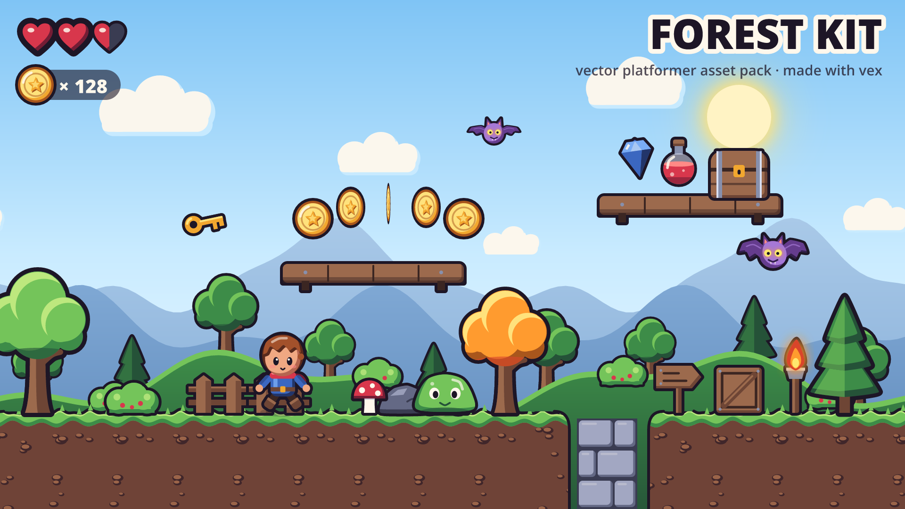

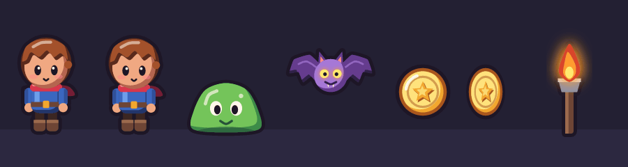

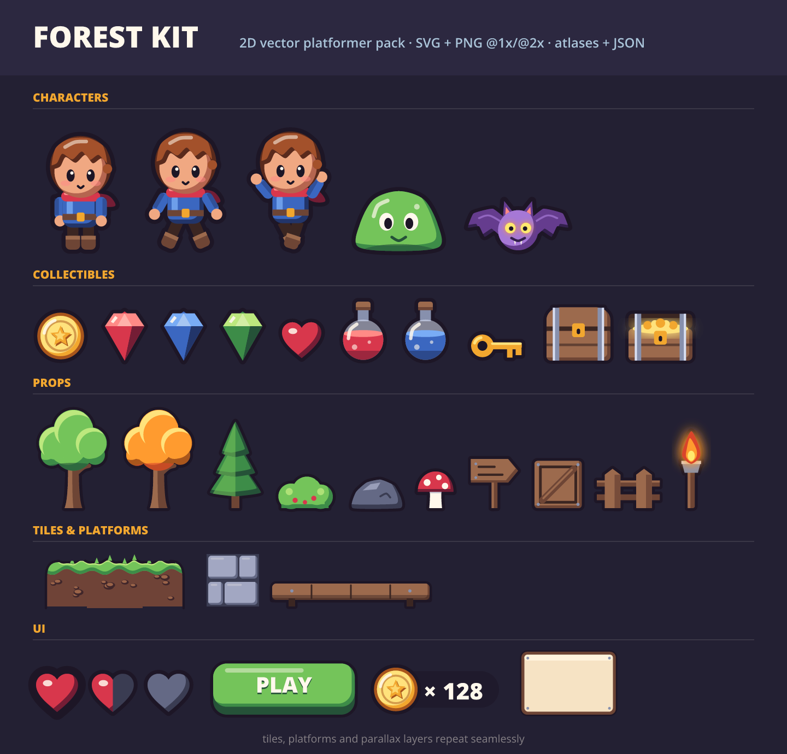

Characters, enemies, collectibles, props, seamless tiles, parallax layers and UI in one style.
Every asset is exported as SVG and PNG @1x/@2x, with atlases + JSON.
Source: [`forest_kit.vx.js`](showcase/forest_kit.vx.js)

| Character atlas | Tile atlas (seamless) |
|---|---|
| 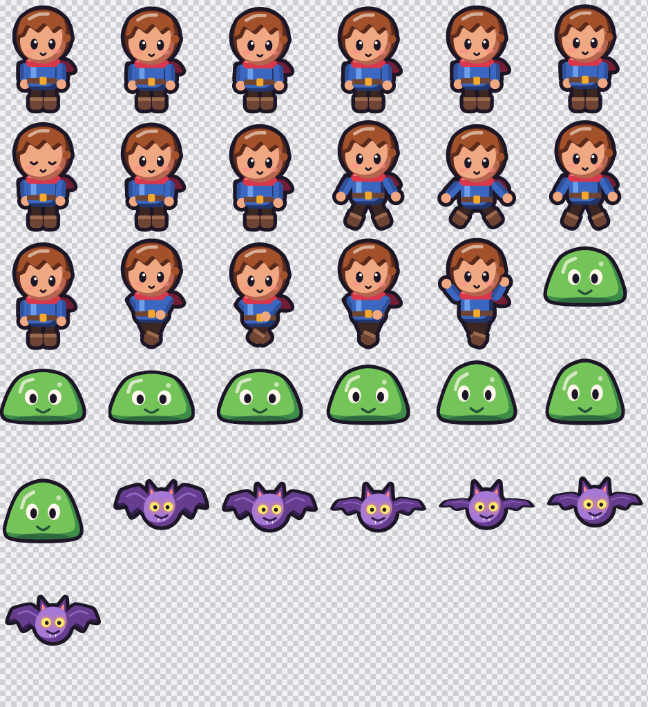 | 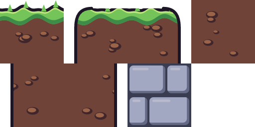 |

## Quick start

```bash
git clone https://github.com/uilianks/vex && cd vex
npm install
node bin/vex.js build examples/basics.vx.js        # -> examples/out/
node bin/vex.js serve showcase/noir_cafe.vx.js     # live viewer on http://127.0.0.1:4322
```

In the viewer, **✎ annotate** (or `a`) lets you draw on the art and pin notes, then *send to Claude*:
the marks land in `out/_feedback/` in the art's own units, so "check the feedback" is all the agent
needs to hear.

Requires Node ≥ 22.18 (it runs the TypeScript sources directly). PNGs are rendered with
[resvg](https://github.com/linebender/resvg), so every PNG is a faithful rendering of its SVG.

```js
pal({ k: "#1b1630", g: "#7bd36a", G: "#3f8f4f", w: "#fff6e0", r: "#e2585e", R: "#a63a4c" })

sprite("slime", { w: 32, h: 26, outline: "k" },
  blob([16, 2, 24, 5, 29, 13, 30, 22, 16, 24, 2, 22, 3, 13, 8, 5], { fill: rad(["g", "G"], { cx: 0.4, cy: 0.3 }) }),
  sym(16, circle(11, 12, 3, "w"), circle(11.6, 12.4, 1.6, "k")))
sprite("slime_red", { base: "slime", swap: { g: "r", G: "R" } })

anim("slime_hop", { w: 36, h: 42, frames: 8, fps: 10 },
  (f) => stamp("slime", 18, 38 - Math.max(0, f.sin(8)), { anchor: "bottom" }))

sheet("enemies", ["slime*", "slime_hop"], { scale: 2 })
```

## Features

- **Shapes:** `rect circle ellipse poly blob curve line path star ngon arc text`. `blob` and
  `curve` pass smoothly through their points, so organic shapes take a few numbers.
- **Paint:** palette keys and ramps, linear and radial gradients, glow, blur, procedural `grain`,
  `blend` modes.
- **Structure:** `tf` transform groups, `sym` mirroring, `clip` for cel shading and highlights,
  automatic silhouette `outline`.
- **Reuse:** parts, `base` + `swap` variants, `stamp`, `tile`, `scatter`, random groups and globs.
- **UI:** 9-slice metadata (`slice`) for Godot / Unity / Phaser and bitmap fonts (`font()`, BMFont).
- **Particles:** `particles()` for fire, smoke, explosions, magic, hits and dust, as looping or one-shot anims.
- **Levels:** `tileset()` + `level()` with autotiling, game objects and generated maps; Tiled .tmj / .tmx export.
- **Skeletal animation:** `rig()` bone hierarchies with pivots and draw order, `pose()` with keyframed
  rotation, offset and scale clips, five easings, procedural channels, and Spine 4.1 export.
- **Animation:** `(f) => items` functions per frame (`f.t`, `f.sin`, `f.cos`, `f.rng`). Anims
  stamped inside anims follow their frames.
- **Output:** SVG, PNG at any scale, animation strips, atlases + JSON for Phaser, PixiJS, Godot
  and similar engines, agent-readable previews.
- **Errors** name `file:line:col` and the asset path, and suggest fixes. One broken asset never
  stops the others.

Agent workflow: [SKILL.md](SKILL.md) · Full API: [reference.md](reference.md)

## Use as a Claude Code skill

```bash
ln -s "$PWD" ~/.claude/skills/vex-vector-art
```

## Development

```bash
npm run check   # typecheck + tests
```

## License

[MIT](LICENSE). Portions adapted from [claude-pxl](https://github.com/crsolver/claude-pxl)
(MIT, © crsolver).
